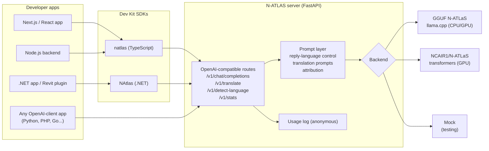

# Architecture

## How a request flows

1. An app calls the SDK (or any OpenAI client) with messages and, optionally, a reply language.
2. The server validates the request and, if `reply_language` is set, injects a system prompt that forces the reply into English, Hausa, Igbo or Yoruba.
3. The chosen backend runs N-ATLAS:
   - **llamacpp** loads a quantized GGUF build of N-ATLAS (4.9 GB Q4) and runs on an ordinary laptop or a GPU.
   - **transformers** loads the official `NCAIR1/N-ATLaS` weights exactly as in NCAIR's model card (Llama-3 chat template, repetition penalty 1.12, low temperature).
   - **mock** returns a predictable reply so developers can build and test before downloading the model.
4. The reply returns in the standard OpenAI response shape, or token-by-token as Server-Sent Events when `stream: true`.
5. An anonymous log line records the endpoint, client name, detected input language, latency and token counts (never the message text). `/v1/stats` summarises it.

## Design decisions

| Decision | Why |
|---|---|
| OpenAI-compatible API | Most developers already use OpenAI-style clients. Compatibility means zero new code to adopt N-ATLAS. |
| GGUF Q4 as default | Lets developers without GPUs run N-ATLAS locally. Most Nigerian developers work on laptops. |
| Official-weights backend too | For teams with GPUs who want full precision and the reference behaviour. |
| Zero-dependency TypeScript SDK | Works in Node, browsers, edge runtimes and Next.js with nothing extra to install. |
| .NET SDK targeting netstandard2.0 + net8.0 | Reaches enterprise, desktop and engineering software (including Revit/AutoCAD plugins on .NET Framework). |
| Single-model lock | An 8B model handles one generation at a time safely; scale out by running more instances. |
| Attribution built in | Every response header, the SDKs and the starter UI carry the required N-ATLaS attribution. |
